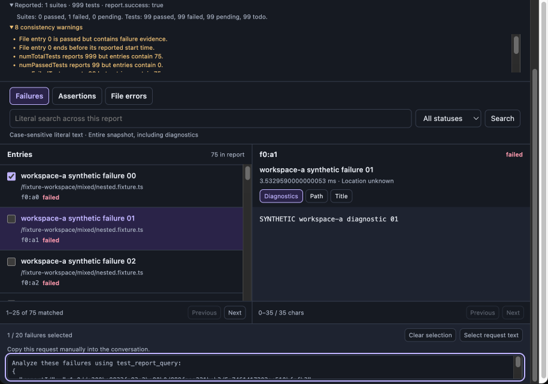
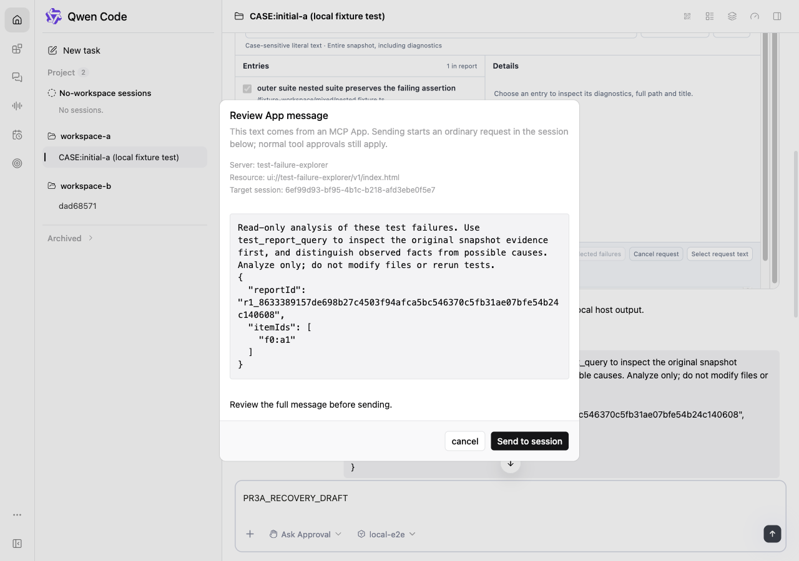
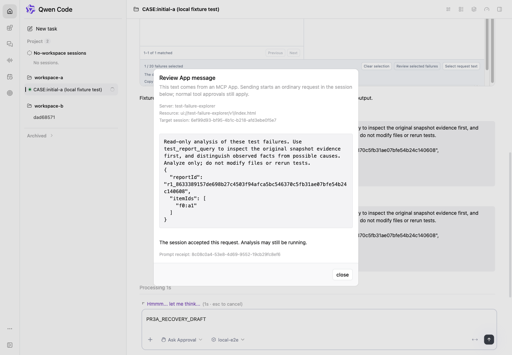
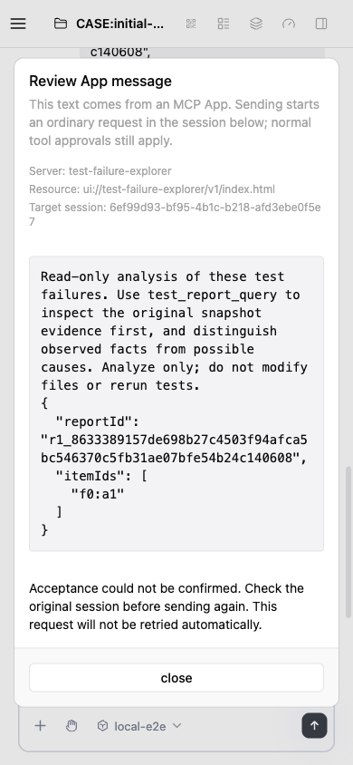

# PR3a: reviewed MCP App messages

Product commit: `1070d92dacb9f742ec9e6007440e591fc4646a17`. Validated base: `30582105fecd0d1159f4d2b894adbeadcd1cef30`, including merged PR2 #13916. The 23 committed source/test files exactly match the candidate that was built, tested and independently accepted. Pre-commit formatting and lint also passed without changing those hashes. Publication-time main `e9b87acd73cd170971970633e20e189814bbe4c1` merges cleanly; this is not a claim that local acceptance was rerun on a merged tree.

Result: **VERIFIED_FIXED**. Local checks and actual-daemon acceptance passed, followed by two clean final self-review passes and independent follow-up review. Hosted CI, external approval and merge remain separate gates.

## Behavior

A standard MCP App text message opens a host-owned review with the full text, host-derived source and original live session. Only explicit host confirmation sends an ordinary prompt. A successful RPC means the daemon returned a real prompt receipt, not that the model finished analysis. The Explorer creates a fixed read-only analysis request from its report and selected failure IDs, with a 20-item maximum and copy fallback when messaging is unavailable.

Pre-dispatch cancellation, expiry, owner changes and App teardown stop submission. A dropped response remains unknown without automatic retry. Closing the App after a receipt does not cancel the accepted turn. Existing composer drafts, preparation hooks and tool approvals remain in effect. Known busy sessions refuse; the ordinary daemon prompt can still queue if another client wins a dispatch race. This stage does not add a busy queue or mid-turn API.

## Local verification

| Check | Result |
| --- | --- |
| Root build; final affected Web Shell and VS Code rebuilds; bundle | Passed |
| Workspace/integration typecheck; SDK public types | Passed |
| Host/actions/bridge/review/i18n | 390/390 |
| Full App file | 1,161/1,161; three transcript cases also passed in the same run |
| SDK session client | 99/99 |
| Explorer, including packed artifacts | 138/138 |
| Embedded host | 45/45 |
| Isolated React 18.3.1 host/bridge DOM | 46/46 |
| Actual SDK timeout/abort transport probe with controlled logical clock | 4/4 |
| Formatting, ESLint and diff checks | Passed |

Some focused runs overlap; the counts above must not be summed as unique tests. Root verification used Node 22.17.0 on macOS. Actual browser/daemon acceptance used Node 25.9.0 and React 19. Windows/Linux and other browser engines were not run locally.

## Actual daemon acceptance

Actual built daemon, freshly packed extension, AppBridge and sandbox; isolated A/B workspaces and normal permission handling. Model responses and report data were deterministic local fixtures. No fake daemon success response was used. This proves host integration and lifecycle behavior, not live-model quality or production behavior.

The initial candidate ran on 2026-10-12 07:03–07:46 UTC. Final fixed-candidate acceptance ran on 2026-10-12 07:51–08:02 UTC and passed **14/14 incremental assertions**. Its recorder observed eight prompt POSTs: five real accepted receipts and three deliberately invalid-client first attempts, plus three real resume requests and zero mid-turn POSTs. Fault injection changed one client header or delayed/dropped an actual response; it did not manufacture a success receipt. See [final-daemon-checks.json](final-daemon-checks.json).

| Final actual-daemon path | Observed result |
| --- | --- |
| Cancel during registration recovery | Real 400 followed by real resume; no second prompt POST from the cancelled review |
| Same-page fresh review after recovery | No reload; recovered client, one real 202/promptId and RPC success while model execution was still held |
| Lost receipt | Real accepted turn, one POST, unknown UI, no misleading generic failure toast, no retry, original draft preserved |
| Host Cancel | Review closed, zero prompt writes, draft preserved |
| A/B ownership during delayed recovery | No late A-review write; B used its own client; A draft remained intact |
| Ordinary composer recovery | Existing 400 → resume → 202 recovery still completed normally |
| Teardown after acceptance | RPC succeeded, then the page was removed with zero remaining iframes; original turn stayed running and subsequently completed |

The source and artifact readback matched all 23 source files, eight build artifacts and three assets actually served over HTTP. [Validated manifest](validated-candidate.json), [publication and screenshot identity](evidence-identity.json). All test-owned browsers/processes exited and their ports closed.

## Acceptance coverage

D = actual daemon/browser or actual embedded host, with explicitly controlled fixture inputs; S = actual SDK transport with logical clock; U = focused unit/DOM coverage. All 21 PR3a entries pass at the stated layer. They are not 21 exhaustive real-browser combinations.

| Case | Layer | Evidence outcome |
| --- | --- | --- |
| P4-01 | D | Automatic App RPC only opens review; no prompt before confirmation |
| P4-02 | D | Unsupported roles/shapes rejected; exact 16 KiB UTF-8 text remains whole |
| P4-03 | D | Host-bound source/owner, forged target ignored, hostile markup displayed literally |
| P4-04 | D | Single receipt and pending duplicate rejection; double-click behavior recorded separately |
| P4-06 | D + S | Host cancel, RPC abort and actual 90-second review expiry; SDK default/explicit timeouts and cleanup |
| P4-07 | D | A/B/A, client recovery, stale review invalidation and fresh review admission |
| P4-08 | D + U | Actual unmount prevents late writes; history/resource/client replacements have DOM regressions |
| P4-09 | D | Real async preparation/before hooks, cancellation and owner changes prevent late submission |
| P4-10 | D | Real receipt settles RPC before model completion |
| P4-11 | D | Cancellation before dispatch, unknown after lost receipt, accepted turn survives teardown |
| P4-12 | D | Downstream tool still requires normal explicit one-time permission |
| P4-13 | D + U | Missing message capability retains query/copy; history mismatch removes messaging in DOM coverage |
| P4-14 | D | Cross-page 20-item maximum, fixed report/IDs, unavailable snapshot produces explicit error |
| P4-15 | D + U | Narrow/wide layout, focus, portal and actual embedding; React 18 compatibility separately covered |
| P4-16 | D | Draft preserved across accepted, rejected, cancelled and unknown results |
| A3-01 | D | Known busy produces no prompt/mid-turn/queue write |
| A3-02 | D | Two-client race accepts an ordinary queued prompt; no atomic-idle claim |
| A3-03 | D | Receipt/RPC success precedes model completion |
| A3-04 | D | Async preflight cancellation and owner invalidation do not write later |
| A3-05 | D | Lost receipt is unknown without a duplicate write |
| A3-06 | D + U | Ordinary composer, recovery, hooks and approvals preserved |

Not separately run: a full React 18 daemon browser session or every visual background-history/pane combination. SDK 60/120-second cases use logical time; the host 90-second review expiry was observed in the real browser. Busy queues/mid-turn delivery belong to the next stage.

## Review findings resolved

- Added a per-attempt lifecycle check after reproducing SDK registration recovery bypassing a one-time dispatch guard. Ordinary callers retain their existing retry behavior.
- Real acceptance exposed a stale provider client after recovery; synchronization is limited to the current SDK object and session. Fresh review, A/B isolation, same-ID replacement and ordinary recovery have regressions.
- Real accepted-response loss exposed a contradictory generic failure toast. App admission errors now retain the dedicated review state while existing cancellation/transcript cleanup runs first. The initial cleanup-order mistake was caught with a failing regression and repaired before the final clean review passes.

Original failing traces and test-harness mistakes remain in local ignored evidence. They are not represented as passing product results. Two final self-review passes and independent full/follow-up review found no remaining actionable issue on this exact source.

## Evidence (Before & After)

Before is the final merged PR2 implementation at `96707ab9889e866fbbfd3f460fb6d4d3817f66dd`, reused from [PR2 acceptance](https://github.com/qqqys/qwen-code/blob/1a4e6f85c4c1f3d46c16a47769634d7caa83fe06/acceptance.md): actual daemon and App card, synthetic 75-failure report, dark theme, 900px inner App width (915×641 captured card including the surrounding scrollbar). It offers manual copy only. After uses this PR's actual daemon with the deterministic one-failure fixture, light theme and host viewports shown below. These illustrate the workflow change; theme, report and framing differences are disclosed and are not a pixel-comparison claim.

| Before: PR2 manual copy | After: host review, 1280×900 |
| --- | --- |
|  |  |

Receipt accepted while the model is still running, 1440×1000:

Lost response, 390×844: unknown acceptance without an automatic retry or a contradictory failure toast:

