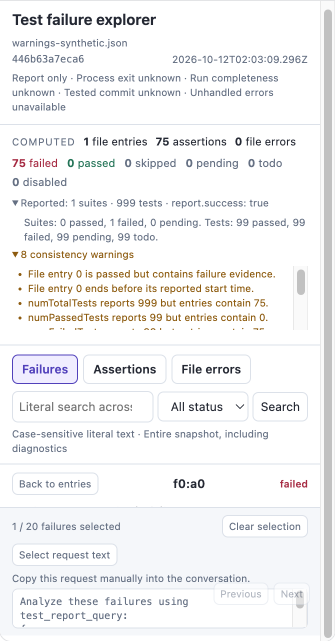
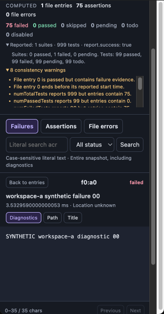
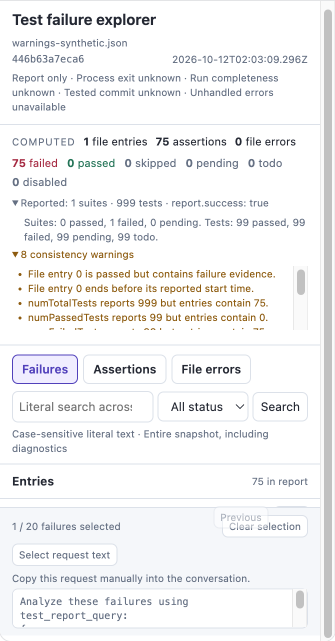
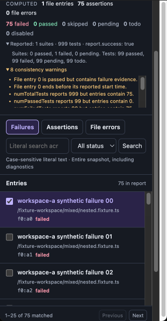
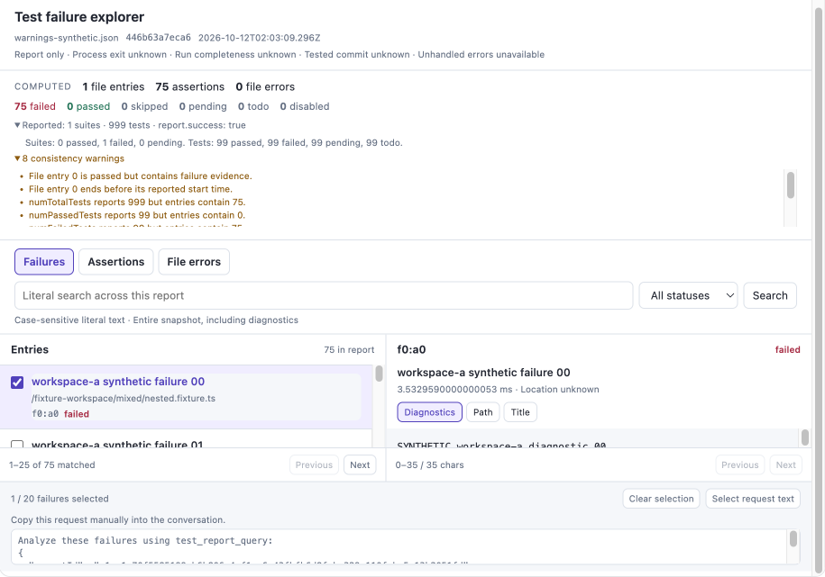
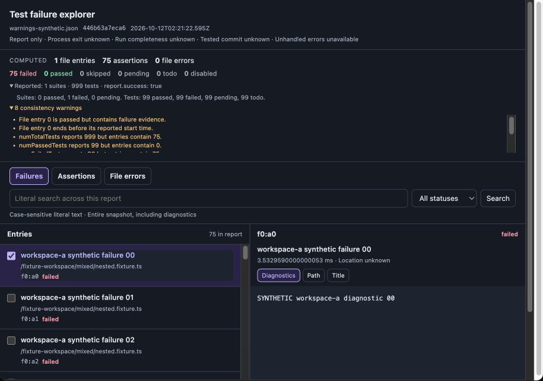

# PR #13916 — Critical R1-36 verification

Fixed commit: `96707ab9889e866fbbfd3f460fb6d4d3817f66dd`. Baseline: `32d2b434a641f31d68cb712f03174f551277531b`. [Critical thread](https://github.com/QwenLM/qwen-code/pull/13916#discussion_r4243718849).

Expanding both report disclosures and selecting a failure could collapse the list and diagnostic viewport behind the footer. The fix preserves the 640px card, reserves a 300px workspace, and allows vertical scrolling inside the card. No host protocol, snapshot, permission, query or model-turn behavior changes. Product logic changes are two CSS declarations; the two additional files provide the browser fixture and regression.

## Local validation

- Root build, typecheck, bundle and complete `lint:ci`: passed.
- Extension: 9 test files, **110/110 passed**; changed-file formatting and diff checks passed.
- New real-browser regression: **4/4 fail on baseline CSS**, **4/4 pass on fixed CSS**. The earlier missing-browser infrastructure attempt is excluded from this red/green evidence.
- The four tests are collected by the existing Chromium `@smoke` project. They exercise the actual ReportApp/styles with an explicit synthetic fixture, eight warnings, a connection notice, selection, 26 entries and multi-fragment diagnostics at 320px and 900px. They require non-collapsed content, ordinary scrolling, centre hit testing, entry/checkbox clicks, both list and detail pagination directions, copy-text focus and a 640px card/document.
- Two clean self-audit passes and an independent read-only review found no new Critical or acceptance blocker. All 27 Suggestions were left unchanged.

Local browser regression used installed Google Chrome through an ignored local config after the pinned browser download stalled. The committed spec uses the existing CI Chromium project without config or dependency changes. Local results do not stand in for fresh hosted CI or review approval.

## Independent actual-host check

Actual rebuilt local daemon → freshly packed extension → AppBridge/sandbox → Chromium. Reports and model traffic are explicitly synthetic; the model is a loopback fixture. Both runs imported the same 75-failure report with eight ordinary consistency warnings (SHA-256 `446b63a7eca6c6ef6c2f7fae94c77e6d94c056885eafeb31d82bceb0f2a1747f`), expanded both disclosures and selected a failure. No CSS, React state or fake disconnect notice was injected into the actual-host check.

| Inner App viewport | Before | After |
| --- | --- | --- |
| 320px, details | Diagnostic viewport **0px**; fetched text was hidden | **151.60px**; the diagnostic glyphs are visible and uncovered |
| 320px, entries | Entry viewport **0px**, 0/25 rows visible; real entry click timed out | **228.10px**, four rows visible; real entry and checkbox clicks succeed |
| 900px, details | Diagnostic viewport **20.81px**; compressed but still partly reachable in this fixture | **156.70px**; diagnostic glyphs are visible and uncovered |
| Both widths | Card/document fixed at 640px with no usable escape from clipped content | Card and host iframe remain **640px**; internal card scrolling reaches entries, pagination and the manual-copy textarea |

At both widths, ordinary scrolling followed by centre hit testing succeeded for all checked controls. Real second-entry clicks, checkbox selection, list Next→Previous and textarea focus passed. The actual-host diagnostic is a single fragment, so its disabled detail pager was hit-tested but not claimed as an active pagination round trip; the committed browser regression separately exercises active detail Next→Previous.

## Evidence (Before & After)

These are actual local App card screenshots, not mockups. Before uses the host's light theme and after its dark theme; this theme difference is disclosed, not a product change. Both use the same report bytes and exact inner viewport widths. After screenshots use ordinary internal scrolling to show the now-reachable content. Screenshot widths include the surrounding sandbox scrollbar, so recorded `innerWidth` is the viewport oracle.

| Case | Before | After |
| --- | --- | --- |
| 320px detail |  |  |
| 320px entries |  |  |
| 900px detail |  |  |

Copy/pagination reachability after ordinary scrolling: [320px footer](after-320-footer-card.png), [900px footer](after-900-footer-card.png). Machine-readable measurements: [measurements.json](measurements.json).

## Artifact identity and boundaries

- Baseline App HTML SHA-256: `a649e1a2399051680ffd820acb8a46787f90d2fa044fbc95499eefe335a1f31e`.
- Fixed App HTML SHA-256: `5c09040f2cce94892511ad32ec9aa6fb258d4b3b6d6b6cf8d3bf725c4ceba03d`.
- Server bundle unchanged: `05e3c3b9e2fbceefa23443bd83892c424868c705af43723876f9b072c9e859e7`.
- The exact source hashes reviewed, built and tested match the pushed commit. Screenshots, reports and plans are outside the product diff.
- Local environment: macOS, Node 25.9.0, pnpm 11.24.0, Chromium engine. This pass does not claim production-data/model validation, Windows/Linux local testing or WebKit verification.
- Fresh hosted CI and automated review are tracked separately on [the PR](https://github.com/QwenLM/qwen-code/pull/13916). Thread resolution means the measured Critical is fixed; it does not grant approval or merge the PR.
