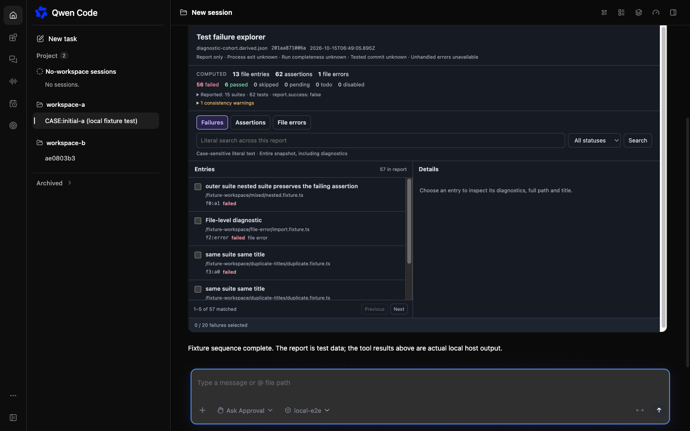
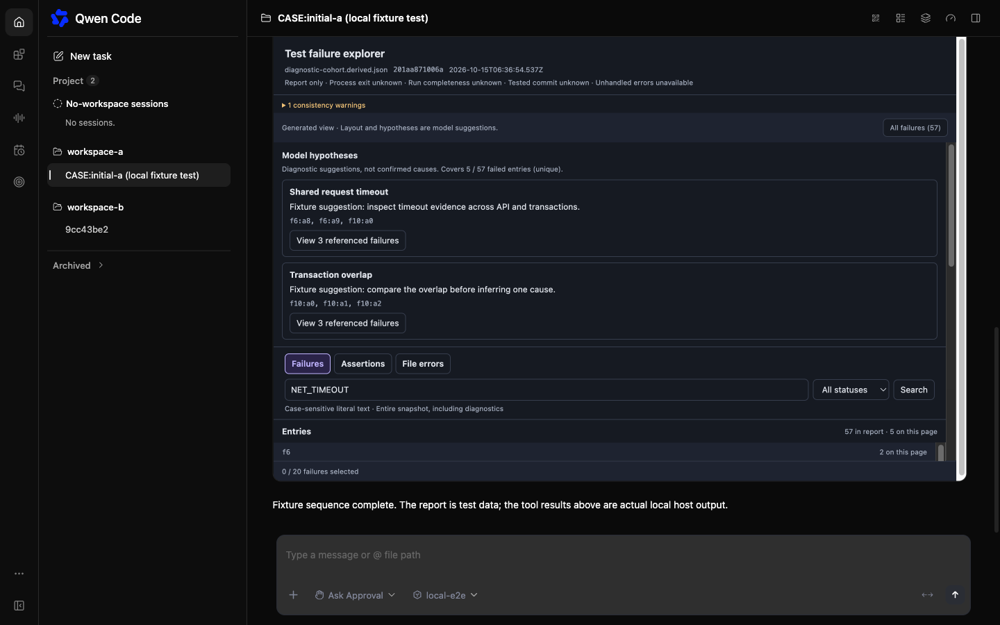
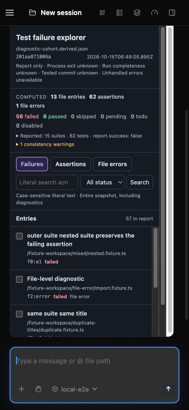
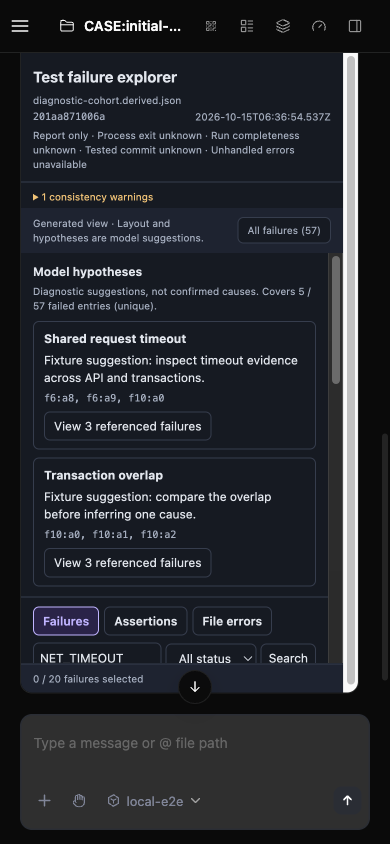

# PR4 Test Failure Explorer acceptance

Recorded 2026-10-15 (Asia/Shanghai). Product commit: `1f78bfa8bd6e7b1226309d457d01947c30f4a7be`. Base: `c1b012539bd860e9e7d679b7c1738bc01fc41b97`, fetched from upstream main before verification. This report distinguishes current-main runtime checks from the earlier frozen model pilot.

## Scope and identity

The PR adds an optional bounded generated layout to the existing MCP App. Ordinary browsing remains fixed. All 15 changed files are within the Test Failure Explorer integration; no new dependencies, lockfile changes, core/daemon/host changes, routes or capabilities are included.

The extension baseline tree was identical before and after synchronization (`e8c752e156d32ecd808db66048bf55c18d182877`). All 15 candidate file SHA-256 hashes stayed unchanged while moving from the prior PR3a head to main. Candidate source digest: `0b2c1e05598f54025cb347d6da700fd0b54bdf599585ca27f35f5dbb5f2da90f`. See [source identity](source-identity.json).

## Current-main verification: 2026-10-15

Local platform: macOS arm64, Node 25.9.0, pnpm 11.24.0. Windows and Linux were not exercised locally. Hosted CI and external review are separate statuses on the PR.

| Check | Result | Evidence boundary |
| --- | --- | --- |
| `corepack pnpm install --frozen-lockfile` | PASS | Install lifecycle ran the full repository build and root bundle successfully on the new base. |
| Full repository typecheck | PASS | Workspace packages and integration tests. |
| Full repository `lint:ci` | PASS | Zero-warning lint command exited 0. |
| Extension tests | 201/201 PASS, 11 files | Run from the extension directory; includes real stdio and an extension package running without repository source/node_modules. Node 25 used `--no-experimental-webstorage`. |
| Formatting and diff integrity | PASS | All 15 changed files, including the two new files; no accidental design/plan artifacts. |
| Real daemon and browser | PASS: P3-01/04/05/06/08/10/11 and PR3a review regression | All 57 failures were reachable through 25/25/7 pagination; cards remained independent. Cancelling host review sent 0 prompt POSTs; confirming sent exactly 1, received HTTP 202 and reached completed, preserving the composer draft. Invalid layouts and missing host capabilities degraded as specified. |
| Independent code review | No confirmed Critical/P2 | Full 15-file candidate plus main compatibility review; not a GitHub approval. |

The prior two clean self-audit passes apply to the identical extension source. The main update was separately reviewed: MCP App callbacks and ownership routing stayed unchanged, and current SDK cancellation/reconnection changes did not alter the extension protocol. Runtime verification was still repeated on the new build.

### Real daemon coverage

| Case | Observed result |
| --- | --- |
| P3-01 | Fixed/default and generated views render; generated section order, chosen columns, page-local file grouping and initial evidence are respected. |
| P3-04 | Overlapping groups show unique coverage 5/57; group filters retain 0/20 selection and intersect other filters. Invalid/duplicate/nonfailed/excess query references are rejected. |
| P3-05 | Initial literal filter matches 7 failures; All failures resets it. Pagination returns 25/25/7 and reaches all 57 unique failures plus the final original diagnostic. |
| P3-06 | Unicode, markup and instruction-like diagnostics render as text. The candidate observation records no injected script/link, unexpected external request or automatic prompt. |
| P3-08 | Twenty packed calls stay within 24,000 characters (maximum 17,764). Effective layout/digest replay is identical. Invalid object layouts fall back with a reason; real-daemon fallback cards remain pageable. Refresh restores initial saved state. |
| P3-10 | No messaging: queries and manual-copy remain usable. No query capability: saved evidence stays readable with unavailable controls disabled. Unknown saved layouts discard a possibly filtered page; unknown outer protocol is rejected; tool input cannot revive a rejected effective view. |
| P3-11 | Exploration does not add a show call, remount or modify the other card, or automatically submit a prompt. |
| PR3a review | Host review text matches the App copy. Cancel: 0 prompt POSTs. Confirm: 1 POST, real HTTP 202, then completed; unsent composer draft remains. |

The deterministic loopback model supplies the test layout and tool sequence. This verifies protocol, renderer, sandbox and host boundaries; it does not measure real-model quality. The fixture contains 56 failed assertions plus one file error, giving 57 computed failures, while the report claims 55 failed tests. That deliberate discrepancy remains visible as a consistency warning. The report cannot prove test-process exit, run completeness, unhandled errors or the tested Git commit.

One initial baseline capture failed because the temporary source archive omitted the root TypeScript configuration. The baseline build warned that its extended configuration was missing, then the incorrectly built App failed with `React is not defined`. The harness was corrected by adding the exact base commit's root configuration and rebuilding only that temporary baseline artifact. The original failed build/runtime records were retained; the before screenshots use the corrected baseline. No product source or candidate/root build artifacts were changed to address this harness failure.

## Before / After

Before uses the extension built and packed directly from the main base; After uses the candidate extension. Both run on the freshly built main daemon/Web Shell with isolated configuration/runtime/workspaces. The same 65,775-byte derived report is used: SHA-256 `201aa871006ae466222b8199dd2ef75762f85ddc98a54eae73a29a95d4934bb1`. Workspace-bound report IDs may differ, but the source bytes match.

| Host viewport | Main fixed view | PR4 generated view |
| --- | --- | --- |
| 1440 × 900 |  |  |
| 390 × 844 |  |  |

Both card tops are aligned at y=52.796875. The four main captures measured equal client/scroll widths in the App and outer frame, with no horizontal overflow. These images were visually checked and were not pixel-edited. They are not screenshots from the real-model pilot. Artifact and image hashes are in [evidence identity](evidence-identity.json).

## Earlier frozen real-model pilot: 2026-10-14

This pilot used the same extension source, Qwen Code 0.24.6 and `openai/qwen3.8-max`. It is not an execution of the new main daemon. Twenty frozen tasks ran once in each of three arms: four simple tasks and sixteen diagnostic tasks per arm. Budgets were 300 seconds, 24 tool calls and 16 turns; maximum concurrency was three. Text/fixed arms finished before the generated arm. No formal run was retried, timed out or failed due to the environment. All 60 runs finished between 08:31:43 and 08:57:42 UTC.

| Arm | Strict main-task score | Simple tasks kept as text | Diagnostic first-attempt valid layouts | Median elapsed time | Input / output tokens |
| --- | --- | --- | --- | --- | --- |
| Text | 17/20 | 4/4 | N/A | 62.35 s | 1,101,363 / 51,003 |
| Fixed | 16/20 | 4/4 | N/A | 61.01 s | 1,242,810 / 50,274 |
| Generated | 18/20 | 4/4 | 16/16 | 82.99 s | 1,500,896 / 67,137 |

All 60 runs matched the target evidence IDs and required quotations under the frozen scorer. All sixteen effective generated specifications independently passed report binding, reference and digest checks. These checks do not establish that every free-text claim was correct.

The original scores are retained, with these qualifications:

- T05 had an ambiguous count scope: three answers supplied 62 total assertions where the frozen oracle expected zero assertions within the failed collection file. This cannot simply be described as a factual computation failure.
- Six T14/T15/T19 failures returned structured objects or ID arrays instead of the expected scalar. The strict score remains unchanged; presentation mismatch is distinct from incorrect evidence.
- Manual review found an inaccurate auxiliary group in generated T11. Generated T13 claimed complete evidence reading despite skipping a middle chunk; text T13 also described its reading sequence inaccurately. Passing the main-task oracle does not excuse these claims.
- Generated runs did not trigger a correction or fallback. Earlier deterministic packed checks passed 13/13, and two bounded correction/fallback sequences passed, but neither proves a real model's correction rate. Those deterministic supplemental checks are dated 2026-10-14 unless explicitly re-executed in the current daemon results above.

The 20/20 task gate was not met. Human time, clicks and productivity were not measured. Generated layouts remain an optional experiment; fixed browsing remains the default. No streaming, cross-turn card replacement, persistent interaction state or general UI-code runtime is claimed.

Frozen task-matrix SHA-256: `5c7051b68abda1ecaf8c37bbc4f57bf43f44c75d685b06d645df45c4f26e135a`. Frozen artifact-lock SHA-256: `33066971e73deff1abfb8fb800c07c677bd146d34788a0cacde1c0c8e1eadf61`. Sanitized aggregate data: [model pilot summary](model-pilot-summary.json).

## Local completion boundary

All task-owned candidate/baseline fixture harnesses, daemons, the capability consumer and browser were stopped; recorded processes and ports were checked. Source files, CLI JavaScript and key build artifact hashes stayed unchanged through acceptance. No user configuration was altered. Local verification is not hosted CI, external approval, merge or deployment. Follow the PR's current checks and review status for those states.
