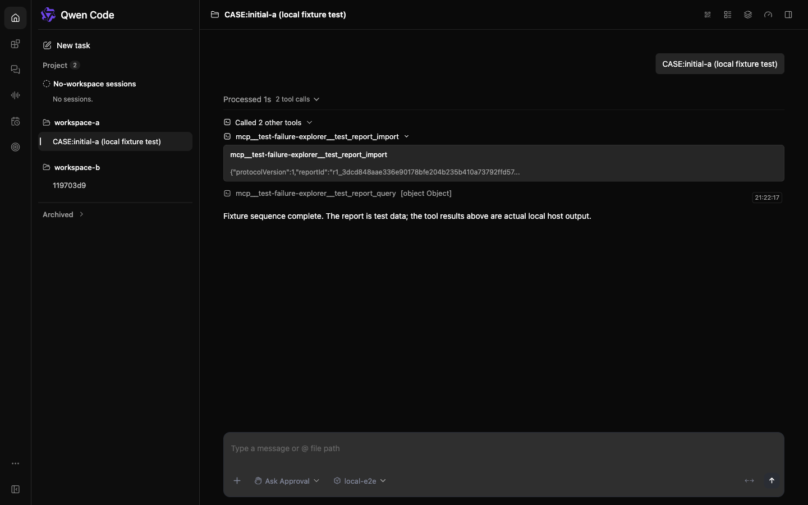
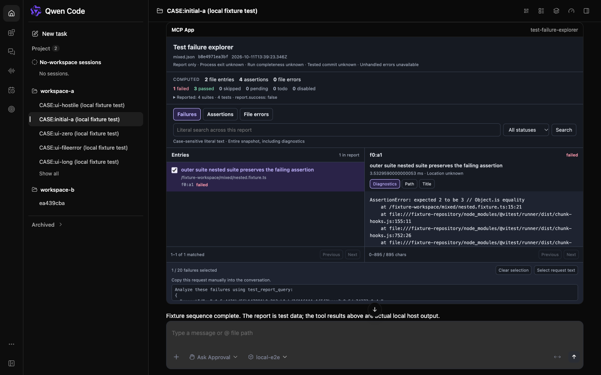
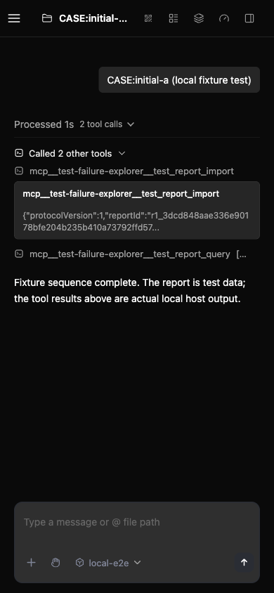
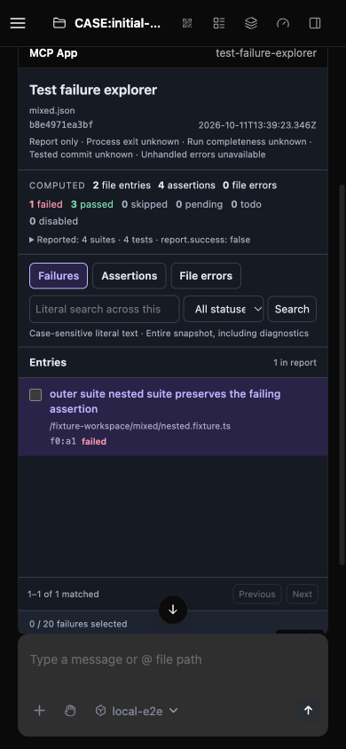

# Test Failure Explorer PR2 — local acceptance

Verified source commit: `0dc4f92318d01c6319da24be63eecb79e0a4004e`. Base: `e6ed740eb16438e7f08ea8c64beb9940206f305d`. Completed 2026-10-11 on macOS, Node 25.9.0, pnpm 11.24.0 and Chromium.

## Scope and result

The fixed MCP App is implemented in the private extension and reuses the existing daemon, AppBridge, sandbox and permission path. It supports immutable report provenance, failure-first browsing, literal search across the full snapshot, independent detail pagination, and manual copying of up to 20 selected failure IDs. No host/runtime changes are included.

| Verification | Observed result |
| --- | --- |
| Extension tests | 110/110 across 9 files, including 13 view DOM, 5 bridge and 5 actual stdio/artifact cases |
| Local gates | Extension build, typecheck, lint, formatting and diff checks passed; root build, typecheck and bundle passed before the two App-only corrections, followed by fresh extension checks |
| Independent MCP protocol checks | 13/13 passed |
| Data traversal | 9/9 passed; 75 unique failures, whole-snapshot search and exact reconstruction of 32,516/30,015/45,091-character path/title/diagnostics |
| Host authorization and ownership | 8/8 passed; workspace A/B separation and denial of model-only, foreign-tool and unregistered-server App calls |
| Actual browser | Pagination, case-sensitive literal search, selection limit, independent field fragments, keyboard and narrow layout passed |
| Failure paths | Missing/corrupt owned cache preserves known summary with explicit error; controlled endpoint failure and missing-serverTools capability preserve known evidence, recover or become read-only |
| Lifecycle | Overwriting the source, browser refresh and daemon restart preserve original identity, counts and exact diagnostics after normal allow-once permission; temporary UI selection resets |
| Model calls | Fixture endpoint request count stayed 32 → 32 during UI and lifecycle operations |
| Review | Two updated clean self-audit passes and independent code review found no additional actionable defects |
| Cleanup | Owned daemons, fixture endpoint and browser processes stopped; endpoint and process readback confirmed |

## Evidence (Before & After)

Actual CLI/daemon/packed extension/AppBridge/browser, with checked-in Vitest 3.2.7 report fixtures and a loopback fake model. These are not production reports or real model calls. The screenshots use the same mixed report; the extra sidebar fixture sessions are test setup.

| Viewport | Before: PR1 text tools | After: PR2 fixed App |
| --- | --- | --- |
| 1440 × 900 |  |  |
| 390 × 844 |  |  |

Before captures show PR1 import/query output with no App resource. After captures show provenance/counts and the fixed report browser. The narrow after image scrolls only the outer transcript to expose the card top; the App remains 640px tall with inner document scrollY 0. Desktop focus and narrow list navigation no longer hide provenance or results.

## Corrections and boundaries

Actual acceptance found and fixed two UI defects: an explicit SDK options object had disabled automatic resize, and a narrow-screen list query left the detail pane active. Both have regression tests and corrected browser evidence. Two test-harness issues were separately corrected: a fixed-size fragment assumption and a disconnected approval observer after daemon restart. Raw failed attempts remain local; they are not product defects.

The CLI/daemon, archive, host and browser are real. Offline is simulated by aborting the App HTTP endpoint; no-serverTools is simulated by removing only that capability from the initialization reply in a separate context. This is local fixture evidence, not hosted CI, merge, release or production validation. Windows, Linux, Node 22 specifically, cross-browser and paid-model runs were not performed locally. Out-of-order replies and protocol/report mismatch are covered by DOM/bridge tests, not independently replayed in the final browser run; a complete hostile-markup/external-network browser audit was not performed.

## Artifact identity

- Extension main SHA256: `05e3c3b9e2fbceefa23443bd83892c424868c705af43723876f9b072c9e859e7`
- Final App HTML: 587,752 bytes; SHA256 `a649e1a2399051680ffd820acb8a46787f90d2fa044fbc95499eefe335a1f31e`
- Packed extension SHA256: `8305b277fd4c8be064b4975bd04f4454b8c0ead3c5312d642d59829124d300e6`
- Source was unchanged by commit hooks and matched the final accepted 20-file hash manifest.

Generated layouts (PR3), model/session message forwarding (PR4), test execution and fixes are out of scope. PR1 was delivered by QwenLM/qwen-code#13854. This evidence branch is separate from the product PR.
