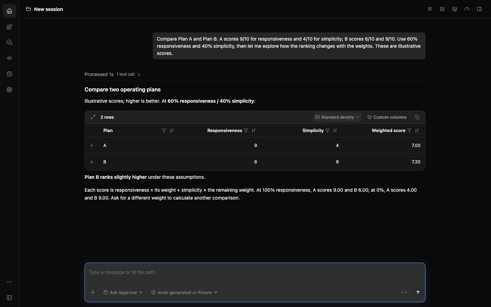
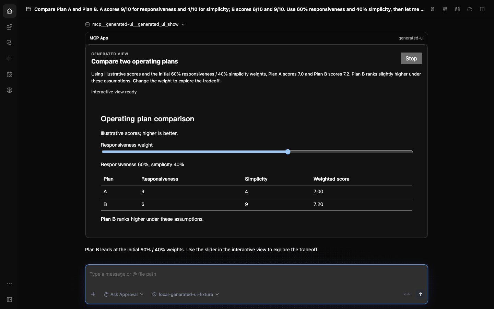
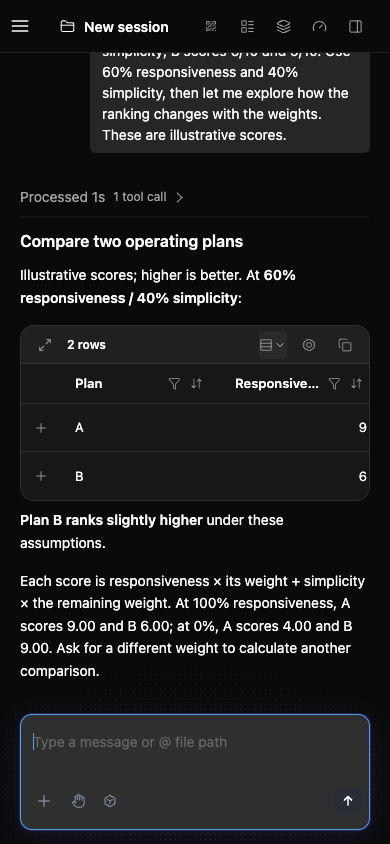
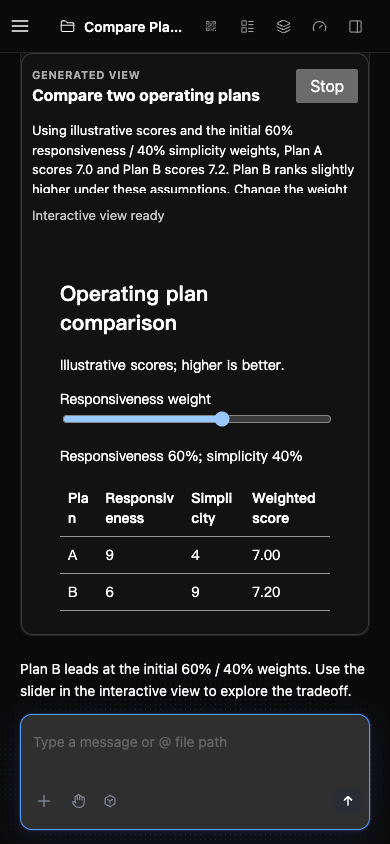

# Generated UI PR7a acceptance

Date: 2026-10-16 (Asia/Shanghai). Product commit: `9e5a8268110caa767f2a2e7f09d6a0318830c02d`. Final upstream base: `4d7294d4fd18db8189e241583ed3885b9139ec2c`. The product diff contains 29 files (the optional extension and its workspace/test registration); plans, logs, runtime configuration and screenshots are excluded from that diff. This separate evidence commit contains only this report and four reviewed screenshots.

## Outcome and scope

One complete `generated_ui_show` call carries HTML, CSS, restricted JavaScript and a standalone summary. The existing MCP Apps host renders an independent immutable card. Local inputs change calculations without another model/tool/message call. Generated JavaScript executes in QuickJS in a dedicated Worker; sanitized HTML renders in a script-disabled nested frame. No core protocol, daemon route or filesystem/network capability was added.

The extension is optional, private and packaged as version 0.25.2. Interaction state is local to the current activation; refresh restores the initial snapshot. Streaming, cross-turn editing of old cards, external libraries and persistent interaction state are outside this increment.

## Validation record

| Validation | Result | Evidence boundary |
| --- | --- | --- |
| Frozen install | PASS | pnpm 11.24.0, no lockfile rewrite beyond the new workspace/variant/checksum |
| Full workspace build, bundle, typecheck, lint | PASS | Run after first sync to `8bd79c9192203f17302d164af424ea9ed6952a59` |
| Final-main delta | PASS | A subsequent main commit changed only independent hosted-team behavior and its tests/docs. Rebuilt the CLI, regenerated the bundle, reran full typecheck, changed-file lint, and 68/68 hosted-team tests on `4d7294d4fd18db8189e241583ed3885b9139ec2c` |
| Extension regressions | 72/72 PASS | 26 contracts, 8 controller, 24 actual QuickJS runtime, 7 surface, 2 actual surface/runtime interactions, 5 built/packed stdio tests. All 29 product file hashes remained identical across the final sync |
| Workspace/script tests | 109 PASS, 1 skipped | Package-script dependency closure and unit-test inventory/timeout checks |
| Formatting and diff checks | PASS | All 29 staged files; no ignored evidence or generated build output staged |
| Fresh real daemon matrix | PASS on first-sync CLI, base `8bd79c9` | Isolated synthetic workspaces, actual packed extension and actual Web Shell; deterministic loopback model, not mocked MCP App rendering |
| Final CLI sanity and paired captures | PASS on final CLI, base `4d7294d` | New isolated configuration after the final CLI rebuild; identities listed below |
| Independent review | No actionable findings | Full 29-file scope/hash inventory, main compatibility, packaging and permission boundaries; independent 17/17 interaction regressions. Prior queued-input and legal-ID findings remain fixed |

The first attempt at a standalone final CLI rebuild reached V8's default approximately 4 GiB heap limit. The exact same source built successfully with `NODE_OPTIONS=--max-old-space-size=8192`; no product change was made for this local resource failure. The earlier full workspace build and both full typechecks passed. This was a local macOS/Node 25.9.0 check, not Windows/Linux or hosted CI evidence. The entire repository unit suite was not run.

## Before / after

The same synthetic question is used for both configurations: compare Plan A (responsiveness 9/10, simplicity 4/10) and Plan B (6/10, 9/10), starting at 60%/40%, and explore the effect of the weights. Before and after both use the final CLI and unchanged Web Shell bundle, English UI and dark theme.

Before has no Generated UI extension, and the real tool inventory/search confirms the tool is absent. The deterministic model answers with Markdown; the existing host already provides a sortable table. After installs the packed extension and obtains a real generated UI tool result, adding a local weight slider and task-specific calculation. This isolates the integration behavior and does not establish model-generation quality.

| Viewport | Before | After |
| --- | --- | --- |
| Desktop: 1440 × 900 |  |  |
| Narrow: 390 × 844 |  |  |

All four images are direct browser viewport captures from the real Web Shell, visually checked for readable content, blank nested frames and accidental private information. No generated mockup or edited image is substituted for a capture.

## Behavioral observations

The full matrix was run on the first-sync CLI (`8bd79c9`) with the exact final extension App/server/package. The subsequent unrelated main increment required a new CLI build; the final CLI run is distinguished below rather than relabeling the earlier matrix.

- Comparison: initial weights 60/40 give A 7.00 / B 7.20; 100/0 gives 9/6 and 0/100 gives 4/9. Capacity: 4×25=100, workers 8 gives 200/40% utilization, rate 15 gives 120/66.7%, and arrivals 300 gives 250% utilization/excess 180. Interleaving these cards leaves each other unchanged.
- Two actual sidebar-selected workspaces remain independent. Refresh restores workers 4 / rate 25 / arrivals 80 / weight 60. During monitored interactions the only requests were the existing attachment GET polling; there were zero POST requests.
- Terminating exactly the two test-owned MCP server processes did not prevent historical replay or local interaction. No matching MCP process existed before or after the refresh; an explicit restart subsequently succeeded.
- Stop made content inert and remained terminal when the same valid captured result was deliberately redelivered by the host.
- The legal `reset` ID survives sanitization. Same-turn Reset→Calculate settles from 20/40 to 10/20, and rapid 5→50 input retains 50 with result 100 and event value 50.
- Duplicate IDs display an explanatory error and retain the summary; a 12,001-character HTML input is rejected without creating another card.
- On the final `4d7294d` CLI, clean-before tool absence, installed tool/card creation, both examples, refresh initialization, the legal-ID/queued-input regressions and the paired captures passed again. The headless CLI also returned a readable capacity summary without HTML/JavaScript source. All three recorded App snapshots matched the exact final App hash. The final observed interaction windows had no network requests and zero browser errors.

Both first-sync test daemons, fixtures, their four listening ports and owned MCP processes were verified stopped; the dedicated browser session was closed. The final CLI run also verified both owned daemons/fixtures exited, all four ports closed, no owned MCP process remained, and the dedicated browser PID was absent. All 1,711 CLI dist files and five bound artifacts were rehashed successfully after acceptance.

## Artifact identities

The final product commit is bound to the tested staged files by a 29-file SHA-256 manifest; committing did not change their contents. The CLI was built from the stated final main plus that same staged source before the commit was created. Its build metadata therefore records the build-time base, rather than claiming a post-commit rebuild.

| Artifact | Size | SHA-256 |
| --- | ---: | --- |
| Fixed App HTML | 789,985 bytes | `e68cb9920e58853c9b94c143bdee652e1e21a63041e3a86e7dedc4440b40b85e` |
| Bundled stdio server | 1,081,752 bytes | `d7f580addb310ee9f811e25e81377fad33752c2e7e081c9a3bab8933e94eb960` |
| CLI launcher | 13,802 bytes | `1c0a76c8e3e9e1faf62bb528714c687b32756735e8102c92dd06663436db31ff` |
| Packed extension 0.25.2 | 572,798 bytes | `155b1af37f84a5b1f11a45b2b2f146ffb40c580ade7c24900b8d3f2ca4288287` |
| Complete CLI dist manifest | 1,711 files | `02b8e86990a182b131ef57ec2ed603af9c7be1dfa9a29cbee8918bf78644756e` |

The App stays below the existing 1 MiB resource limit. No host limit was raised. The final App and server match the already reviewed/fixed artifacts byte for byte; the package metadata version was aligned with main.

## Earlier evidence and limitations

Before this submission run, the same final App/server passed browser checks in both normal and data-URL host modes, including the fixed queued-input and legal-ID regressions, local computation, output bounds and capability probes. Earlier broad stress/lifecycle matrices also exist, but they are not described here as a complete rerun on the new CLI. Network tests observed blocked CSS request attempts and zero requests reaching the controlled sink; “no outbound request succeeded” is distinct from “no request was attempted.”

Two earlier actual `kimi-k3` generated examples (synthetic capacity and weighted comparison tasks) were accepted without editing their generated source and verified against the same final App in both host modes. No paid model call was repeated for the submission screenshots. This is two examples, not a quality benchmark. The capacity example retained two wording discrepancies: its summary described 80% as green while the view displayed orange, and it described zero values too broadly although zero arrivals were valid. Passing arithmetic/interaction tests does not establish the accuracy of all generated explanations.

JavaScript has no browser DOM, network, imports, timers, filesystem, MCP-tool or message API. Guest limits are 32 MiB heap, 256 KiB stack and 250 ms per round, with parent watchdogs and bounded inputs/patches. HTML/CSS and document bounds provide additional limits, but this does not claim to bound every browser rendering workload or prove the absence of all sandbox defects.

Hosted CI and external review are separate from this local acceptance. Check the PR's current status for those results. No scheduled monitor was created.

## 中文验收摘要

已同步最终 main 并完成本地复验，产品提交只包含 29 个扩展及 workspace 接入文件。扩展 72/72、workspace 109 通过/1 跳过，最后一次 main 增量相关测试 68/68；构建、打包、typecheck、lint、格式和 diff 检查通过。CLI 单包重建曾触及默认 4 GiB 堆限制，同源码以 8 GiB 重试成功，未为此修改产品代码。

真实 daemon 验收、最终 CLI 复验和四张前后截图使用隔离配置与合成数据；确定性 loopback 模型负责提供响应，MCP 扩展和 Web Shell 渲染链路是真实运行。截图基线本来就有可排序 Markdown 表格，本次新增的是任务专属 JS 本地计算交互。测试环境为 macOS；不将本地结果混同为远端 CI、跨平台验证或通用模型生成质量结论。
