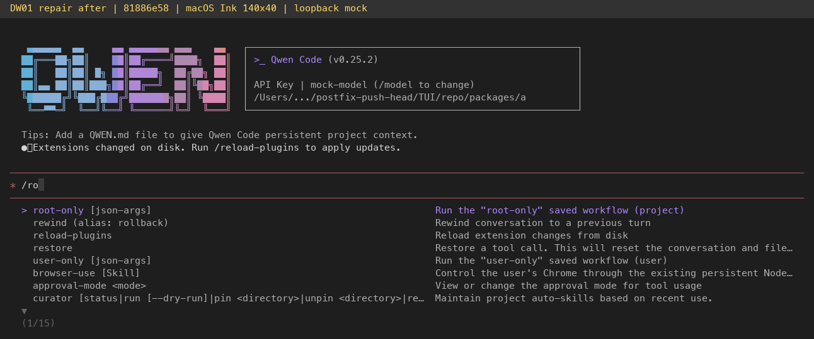
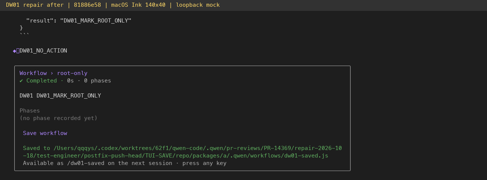

# DW-01 PR #14369 repair evidence

Product head: `81886e580ac984722f69412c8ab02d40aeb292a1`. Upstream merged: `193e3652900c598f568e8444286a7a09549921f1`. This evidence-only branch is separate from the product diff.

- [23 review dispositions](review-dispositions.md): every original comment, valid repairs, test gaps and reasons proposed patches were not adopted. R1-1 core listing semantics remain for reviewer discussion; its real ACP consumer defect is repaired.
- [Local validation](validation.json): core403, CLI1944, CI meta63 (2 OS skips), 14 integration cases; full build/typecheck and affected rebuild inheritance, lint/format and both serve gates.
- [Independent final runtime verification](postfix-report.md), [structured summary](postfix-summary.json): 10 regression assertions + 19 original E2E assertions, all PASS at final head.
- [Independent code review](final-independent-review.md) and [self audit](self-audit.md).
- [Source manifest](source-manifest.json), [runtime manifest](runtime-manifest.json), [before](provenance-before.json) / [after](provenance-after.json) independent hash verification. All23source and1446runtime files match; entry/chunks/metafile included.
- [Regression assertions](priority-assertions.json) and [original assertions](assertions.json); detailed real filesystem, CLI/ACP and state records are attached as JSON.

## Actual terminal evidence

Images faithfully render captured macOS Ink PTY/xterm cells at140x40 with separate captions. They are not desktop screenshots or model generated mockups. Runs use isolated HOME/QWEN_HOME/runtime and a deterministic loopback OpenAI-compatible mock. Discovery uses explicit YOLO; digest approval checks use default ACP mode. No real model credentials or Windows/Linux filesystem E2E are claimed. Raw readable frame text is included.

The immutable feature-before captures at upstream87de7486 remain on evidence commit f65874f30e0836be30064918a2b2eaa7d0517343 under pr-evidence/dw-01/. These final images supersede the earlier1ca feature-after captures.

Hosted CI, review approval and mergeability are separate live GitHub states, not established by these local records.
