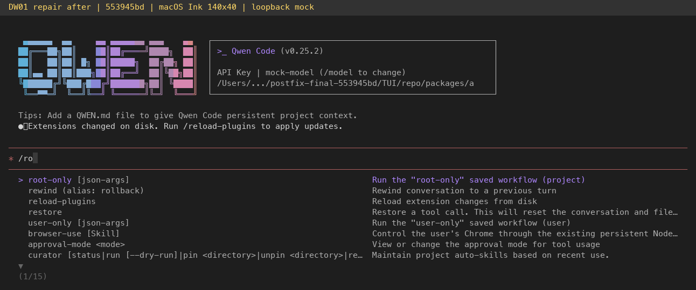
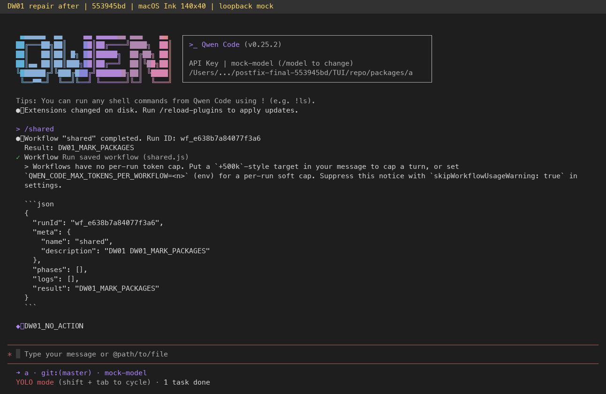
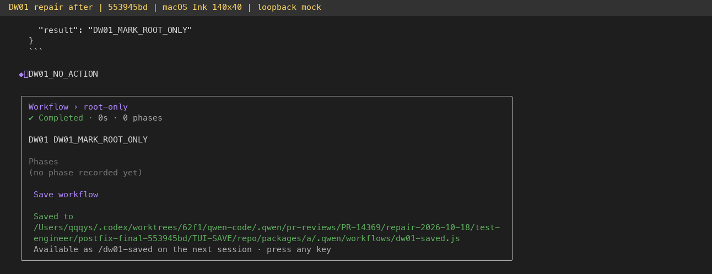

# DW-01 PR #14369 final repair evidence

Product head: `553945bd02dd93826acdeb40dbdc0c80baa7bb18`. Upstream merged: `193e3652900c598f568e8444286a7a09549921f1`. This evidence-only branch is separate from the product PR diff.

- [23 review dispositions](review-dispositions.md): every original comment, valid repairs and regression gaps, with reasons proposed patches were not adopted. R1-1 core listing semantics remain open for reviewer agreement; its real ACP consumer defect is repaired.
- [Local validation](validation.json): core403, CLI1944+4, CI meta63 (+2 OS skips),14 integration cases; exact full-build/typecheck and affected-rebuild inheritance, lint/format and both serve gates. The last change supplies a missing helper in a worktree-only test mock; all production bytes remain unchanged.
- [Independent final runtime verification](postfix-report.md) and [structured summary](postfix-summary.json): repair10 + original19 assertions, all PASS on final head.
- [Independent code review](final-independent-review.md) and [self audit](self-audit.md).
- [Source manifest](source-manifest.json), [runtime manifest](runtime-manifest.json), [before](provenance-before.json) / [after](provenance-after.json) independent hash verification: all24source and1446runtime files match, including entry/chunks/metafile. CLI SHA256 `ada257f3c1dacbc5ffaf6480bcaa09eff42eaffaa9531bb63f8b55d5a5f5949d`.
- [Repair assertions](priority-assertions.json), [original assertions](assertions.json), detailed filesystem/CLI/ACP JSON and readable terminal text.

## Actual terminal evidence

Images faithfully render captured macOS Ink PTY/xterm cells at140x40 with separate captions. They are not desktop screenshots or generated mockups. Isolated HOME/QWEN_HOME/runtime, deterministic loopback OpenAI-compatible mock, no real model credentials. Discovery uses explicit YOLO; digest approval checks use default ACP mode. No Windows/Linux filesystem E2E, Windows ACL or cross-UID attack execution claim.

The immutable feature-before captures at upstream87de7486 remain on evidence commit f65874f30e0836be30064918a2b2eaa7d0517343 under pr-evidence/dw-01/. Earlier81886/6dcc repair runs remain historical records.

Hosted CI, reviewer approval and mergeability are separate live GitHub states, not established by these local records.
